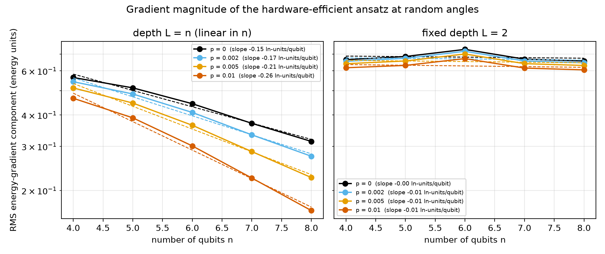
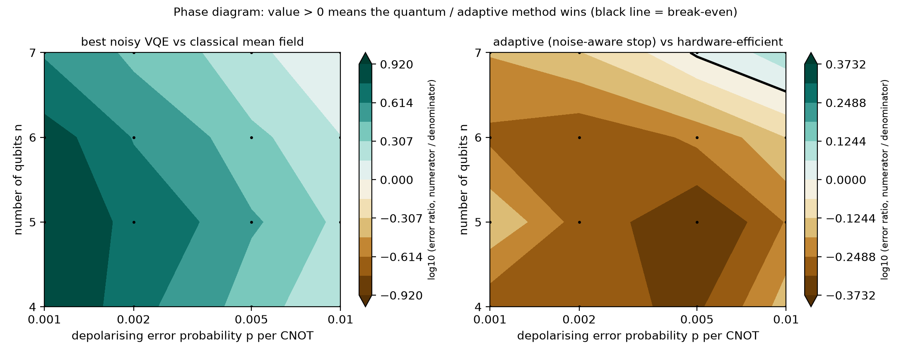
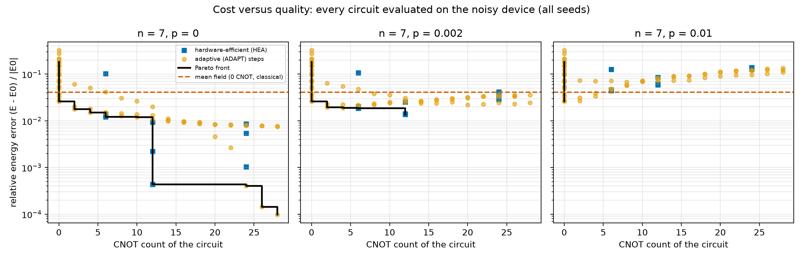
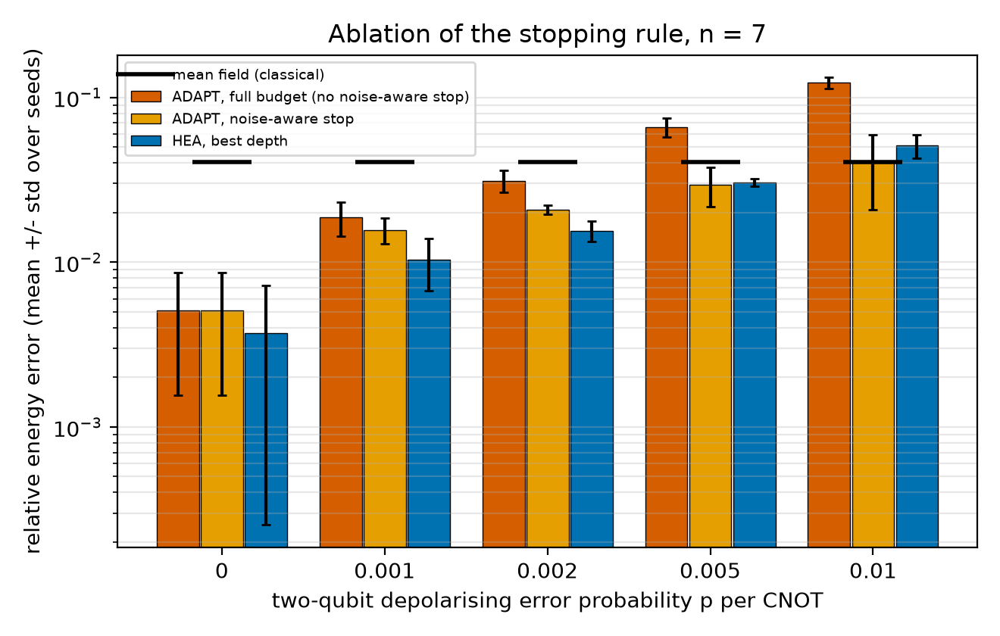

# Adaptive versus Hardware-Efficient Variational Eigensolver Ansatz under Noise-Induced Barren Plateaus

[](LICENSE)
[](pyproject.toml)
[](.github/workflows/ci.yml)

## Abstract

This simulation study compares two ways of building the circuit of a Variational Quantum Eigensolver (VQE) on a noisy device: a fixed hardware-efficient ansatz (HEA) and an adaptively grown ansatz in the style of adaptive derivative-assembled pseudo-Trotter VQE (ADAPT-VQE), both charged by their controlled-NOT (CNOT) count under depolarising noise. On a disordered transverse-field Ising chain with 4 to 8 qubits (exact density-matrix simulation, 3 disorder seeds), the root-mean-square (RMS) gradient of a depth-linear HEA decays by a factor exp(-0.150) per qubit without noise and exp(-0.2615) per qubit at a CNOT error probability of 0.01, whereas a depth-2 HEA does not decay measurably. Against a zero-CNOT classical product-state (mean-field) baseline, the best noisy circuit stays ahead up to the largest noise level tested (0.01) in most cells, adaptive growth with a measured-energy stopping rule beats the best fixed-depth HEA only at n = 7 and p >= 0.005, and the prediction that it wins generally is falsified.

## Motivation

Variational circuits are the working algorithm of near-term hardware, yet their trainability is limited by barren plateaus, where gradients vanish exponentially with system size. Noise alone is enough to cause this: local Pauli noise flattens the landscape when depth grows linearly with the number of qubits. A practitioner choosing between a fixed circuit and a circuit that grows on the device needs concrete numbers, namely at which size and error rate gradients become expensive to resolve and whether the quantum circuit still beats a free classical estimate.

## Research gap

State of the art (details and a 12-paper related-work table in [`docs/RESEARCH_GAP.md`](docs/RESEARCH_GAP.md)):

- Kandala et al., 2017, doi:10.1038/nature23879 established the HEA on superconducting hardware.
- Cerezo et al., 2021, doi:10.1038/s41467-021-21728-w proved that global cost functions cause barren plateaus and local ones do not for logarithmic depth.
- Wang et al., 2021, doi:10.1038/s41467-021-27045-6 proved noise-induced barren plateaus (NIBP) when depth grows linearly with n.
- Grimsley et al., 2019, doi:10.1038/s41467-019-10988-2 proposed ADAPT-VQE, which grows shallow circuits, with noiseless evidence.
- Tilly et al., 2022, doi:10.1016/j.physrep.2022.08.003 and Larocca et al., 2025, doi:10.1038/s42254-025-00813-9 list vanishing gradients and hardware noise as open problems.

What is missing is a measurement, under one noise model and one CNOT cost accounting, of (i) the finite-size gradient decay of the HEA, (ii) whether growing the circuit on the noisy device beats the best fixed depth, and (iii) the noise level below which any entangling ansatz beats a free classical mean-field state.

## What is new here

- One noise model and one cost accounting for both ansatz families: every CNOT is charged depolarising noise, and a two-qubit Pauli rotation is charged two CNOTs.
- ADAPT is run on the noisy device itself: operator selection uses exact noisy parameter-shift gradients and all angles are re-optimised on the noisy energy, with a stopping rule that uses only the measured energy.
- Results are anchored to a zero-cost classical product-state baseline, giving a break-even noise level instead of a bare error curve.
- Gradient decay rates are reported with and without noise, plus a shot-cost proxy for resolving a gradient.

## Hypotheses

Fixed before the full run (criteria in `docs/RESEARCH_GAP.md`):

- **H1.** For depth L = n the decay rate of the RMS gradient is more negative at p = 0.01 than at p = 0 by at least 0.1 ln-units per qubit, and by less for L = 2.
- **H2.** For n >= 5 and p >= 0.002, noise-aware ADAPT beats the best-depth HEA in at least 2 of 3 seeds.
- **H3.** The break-even noise level against mean field does not increase with n.

## Method

```mermaid
%%{init: {'theme': 'base', 'themeVariables': {'primaryColor': '#ffffff', 'primaryTextColor': '#000000', 'primaryBorderColor': '#000000', 'lineColor': '#000000', 'secondaryColor': '#ffffff', 'tertiaryColor': '#ffffff', 'background': '#ffffff', 'noteBkgColor': '#ffffff', 'noteTextColor': '#000000', 'actorBkg': '#ffffff', 'actorBorder': '#000000', 'actorTextColor': '#000000', 'signalColor': '#000000', 'signalTextColor': '#000000', 'labelBoxBkgColor': '#ffffff', 'labelTextColor': '#000000', 'clusterBkg': '#ffffff', 'clusterBorder': '#000000'}}}%%
flowchart TD
  subgraph IN["Inputs"]
    A["hamiltonian.py<br/>disordered Ising chain<br/>n = 4 to 8 qubits, 3 seeds"]
    B["Noise model<br/>depolarising channel, probability p<br/>after every CNOT"]
  end
  subgraph CORE["Candidate circuits - circuits.py, optimise.py"]
    C["Classical baseline<br/>mean-field product state<br/>meanfield.py, 0 CNOT"]
    D["Standard quantum baseline<br/>hardware-efficient ansatz, depth 1, 2, 4<br/>keep best depth"]
    E["Adaptive ansatz<br/>pick Pauli rotation with largest<br/>noisy gradient, re-optimise all angles"]
    F["Stopping rules<br/>noise-aware: lowest measured energy<br/>full budget: 3n operators"]
  end
  subgraph EVAL["Evaluation - study.py, gradients.py"]
    G["Relative energy error<br/>mean and std over seeds"]
    H["Gradient scaling<br/>RMS gradient at random angles<br/>depth n and depth 2"]
    I["Break-even noise level<br/>versus mean field, CNOT cost,<br/>Pareto front"]
  end
  A --> C
  A --> D
  A --> E
  B --> D
  B --> E
  E --> F
  C --> G
  D --> G
  F --> G
  D --> H
  G --> I
  classDef bw fill:#ffffff,stroke:#000000,color:#000000,stroke-width:2px;
  class A,B,C,D,E,F,G,H,I bw;
```

Legend: CNOT = controlled-NOT gate; RMS = root-mean-square; std = standard deviation.

Target: H = -sum J_i Z_i Z_(i+1) - sum g_i X_i on an open chain, J_i and g_i drawn from [0.5, 1.5]; metric (E - E0) / |E0| with the exact ground energy E0. Noise: depolarising channel of Pauli error probability p on both qubits after each CNOT; a two-qubit Pauli rotation costs two CNOTs; single-qubit rotations are noiseless. Mean field: best real product state (0 CNOT, independent of p). HEA: single-qubit Y rotations plus CNOT ladder, depth in {1, 2, 4}, random start, optimiser on the noisy energy, best depth kept. ADAPT: pool of Pauli rotations with one Y factor (single-qubit and nearest-neighbour), up to 3n operators, noisy parameter-shift selection. Full description: [`docs/METHOD.md`](docs/METHOD.md).

## Results

All numbers are from `results/` (full run, three seeds, mean ± standard deviation). Relative energy error, lower is better. "Best VQE beats MF" is the fraction of seeds where the better of HEA and noise-aware ADAPT is more than 2 percent below the mean-field error. Mean field (MF) values do not depend on p.

| n | p | mean field | HEA best depth | HEA CNOTs | ADAPT full budget | ADAPT noise-aware | ADAPT CNOTs | ADAPT beats HEA | best VQE beats MF |
|---|---|---|---|---|---|---|---|---|---|
| 4 | 0 | 0.0451 | 0.0000 ± 0.0000 | 12.0 | 0.0000 ± 0.0000 | 0.0000 ± 0.0000 | 15.3 | 0.33 | 1.00 |
| 4 | 0.001 | 0.0451 | 0.0054 ± 0.0005 | 6.0 | 0.0135 ± 0.0005 | 0.0106 ± 0.0003 | 12.0 | 0.00 | 1.00 |
| 4 | 0.002 | 0.0451 | 0.0100 ± 0.0013 | 4.0 | 0.0267 ± 0.0010 | 0.0200 ± 0.0011 | 10.0 | 0.00 | 1.00 |
| 4 | 0.005 | 0.0451 | 0.0193 ± 0.0036 | 3.0 | 0.0638 ± 0.0017 | 0.0404 ± 0.0052 | 6.7 | 0.00 | 1.00 |
| 4 | 0.01 | 0.0451 | 0.0318 ± 0.0039 | 3.0 | 0.1204 ± 0.0039 | 0.0451 ± 0.0095 | 0.0 | 0.00 | 1.00 |
| 5 | 0 | 0.0572 | 0.0001 ± 0.0001 | 16.0 | 0.0000 ± 0.0000 | 0.0000 ± 0.0000 | 20.0 | 1.00 | 1.00 |
| 5 | 0.001 | 0.0572 | 0.0076 ± 0.0016 | 6.7 | 0.0129 ± 0.0004 | 0.0104 ± 0.0006 | 14.7 | 0.00 | 1.00 |
| 5 | 0.002 | 0.0572 | 0.0109 ± 0.0014 | 5.3 | 0.0252 ± 0.0012 | 0.0208 ± 0.0013 | 14.0 | 0.00 | 1.00 |
| 5 | 0.005 | 0.0572 | 0.0189 ± 0.0017 | 4.0 | 0.0610 ± 0.0022 | 0.0446 ± 0.0017 | 8.7 | 0.00 | 1.00 |
| 5 | 0.01 | 0.0572 | 0.0316 ± 0.0020 | 4.0 | 0.1172 ± 0.0038 | 0.0555 ± 0.0076 | 2.0 | 0.00 | 1.00 |
| 6 | 0 | 0.0491 | 0.0008 ± 0.0004 | 20.0 | 0.0037 ± 0.0049 | 0.0037 ± 0.0049 | 24.0 | 0.67 | 1.00 |
| 6 | 0.001 | 0.0491 | 0.0072 ± 0.0003 | 10.0 | 0.0141 ± 0.0013 | 0.0133 ± 0.0019 | 22.0 | 0.00 | 1.00 |
| 6 | 0.002 | 0.0491 | 0.0122 ± 0.0016 | 6.7 | 0.0270 ± 0.0022 | 0.0243 ± 0.0030 | 20.7 | 0.00 | 1.00 |
| 6 | 0.005 | 0.0491 | 0.0225 ± 0.0045 | 5.0 | 0.0626 ± 0.0036 | 0.0383 ± 0.0023 | 5.3 | 0.00 | 1.00 |
| 6 | 0.01 | 0.0491 | 0.0360 ± 0.0048 | 5.0 | 0.1155 ± 0.0019 | 0.0479 ± 0.0108 | 0.7 | 0.33 | 0.67 |
| 7 | 0 | 0.0407 | 0.0037 ± 0.0035 | 16.0 | 0.0051 ± 0.0035 | 0.0051 ± 0.0035 | 28.0 | 0.67 | 1.00 |
| 7 | 0.001 | 0.0407 | 0.0103 ± 0.0036 | 10.0 | 0.0187 ± 0.0043 | 0.0157 ± 0.0028 | 14.7 | 0.00 | 1.00 |
| 7 | 0.002 | 0.0407 | 0.0155 ± 0.0023 | 10.0 | 0.0312 ± 0.0048 | 0.0208 ± 0.0014 | 10.0 | 0.00 | 1.00 |
| 7 | 0.005 | 0.0407 | 0.0304 ± 0.0017 | 8.0 | 0.0662 ± 0.0088 | 0.0296 ± 0.0080 | 6.7 | 0.67 | 0.67 |
| 7 | 0.01 | 0.0407 | 0.0511 ± 0.0083 | 8.0 | 0.1224 ± 0.0098 | 0.0401 ± 0.0193 | 3.3 | 0.67 | 0.67 |

Gradient scaling (`results/gradient_decay_fits.csv`, `results/gradient_scaling.csv`): fitted slope of ln(RMS gradient) per added qubit, n = 4 to 8.

| p | slope, depth L = n | slope, depth L = 2 |
|---|---|---|
| 0 | -0.1500 | -0.0049 |
| 0.002 | -0.1745 | -0.0052 |
| 0.005 | -0.2091 | -0.0056 |
| 0.01 | -0.2615 | -0.0063 |

At n = 8 and depth L = n the RMS gradient falls from 0.314 (p = 0) to 0.166 (p = 0.01) and the shot-cost proxy rises from 177.5 to 631.4; at depth L = 2 it moves only from 40.7 to 47.8.



*Figure 1. Takeaway: with depth linear in n, noise steepens the exponential gradient decay from -0.150 to -0.2615 ln-units per qubit; at fixed depth 2 the gradient stays flat.*



*Figure 2. Takeaway: the best noisy circuit beats mean field in every cell shown (left, value > 0), with the margin shrinking as p and n grow; adaptive growth beats the fixed-depth HEA only in the top-right corner (right, inside the black line).*



*Figure 3. Takeaway: at n = 7 and p = 0.01 only circuits with at most 4 CNOTs fall below the zero-CNOT mean-field line; every circuit with 8 or more CNOTs lies above it.*



*Figure 4. Takeaway: at n = 7 and p = 0.01 stopping ADAPT at the lowest measured energy lowers the error from 0.1224 to 0.0401 compared with running the full operator budget.*

Break-even noise (`results/noise_crossover.csv`): the largest tested p at which a method beats mean field in at least half of the seeds.

| n | HEA | ADAPT noise-aware | best of the two |
|---|---|---|---|
| 4 | 0.01 | 0.005 | 0.01 |
| 5 | 0.01 | 0.005 | 0.01 |
| 6 | 0.01 | 0.005 | 0.01 |
| 7 | 0.002 | 0.005 | 0.01 |

The value 0.01 is the upper edge of the tested grid, so for the best circuit it is a lower bound on the true break-even level.

## Discussion

**H1 is supported.** The depth-linear HEA gradient shrinks by exp(-0.150) per qubit even at p = 0, the noise-free barren-plateau effect of random angles, and by exp(-0.2615) per qubit at p = 0.01, a difference of -0.1115 (threshold 0.1). At depth 2 the difference is -0.0014. The noise-induced part therefore matters only when depth grows with n. The sample is five sizes and the fit is a two-parameter line, so the rates are indicative.

**H2 is falsified.** Noise-aware ADAPT lost to the best-depth HEA in all three seeds at n = 4, 5, 6 for p = 0.001, 0.002 and 0.005, and at n = 7 for p = 0.001 and 0.002. It won in two of three seeds only at n = 7 for p = 0.005 (0.0296 versus 0.0304) and p = 0.01 (0.0401 versus 0.0511), where the margins are inside one standard deviation at p = 0.005. One cause is the cost model: a two-qubit Pauli rotation costs two CNOTs, while one CNOT of the HEA ladder entangles a pair. A second cause is that the best HEA at p > 0 is a shallow circuit (3 to 10 CNOTs on average), which ADAPT only reaches after a long single-qubit prefix. At p = 0 and n = 6, 7 ADAPT at 3n operators has not converged (0.0037 and 0.0051, against 0.0008 and 0.0037 for the HEA).

**Stopping rule.** The ablation is clear: the measured-energy stop reduces ADAPT error by a factor of 2.4 to 3.1 at p = 0.01 (0.1155 to 0.0479 at n = 6; 0.1224 to 0.0401 at n = 7). Without it, growth keeps adding noisy CNOTs after the energy has started rising. At n = 4 and p = 0.01 the rule stops with zero CNOTs, which reproduces the mean-field error (0.0451).

**H3 is not falsified, but the data are censored.** The best circuit still beats mean field at p = 0.01 for n = 4 to 7, so the break-even level at n = 7 does not exceed that at n = 4 only because both sit on the grid edge. The more informative signals are that the fraction of seeds in which any circuit beats mean field drops from 1.00 to 0.67 at n = 6 and n = 7 for p = 0.01, and that the HEA alone falls from 0.01 (n <= 6) to 0.002 at n = 7. The deepest HEA tested (depth 4) is worse than mean field already at p = 0.01 for n = 6 and 7 (0.1232 and 0.1340 versus 0.0491 and 0.0407, `results/summary_by_size_and_noise.csv`).

**Mean field is a strong competitor.** With 4 to 7 qubits and a gapped, near-critical disordered chain, the classical product state has an error of 0.04 to 0.06 at no cost. At p = 0.01 the better circuit of each seed (column `eps_quantum_best_mean` in `results/summary_by_size_and_noise.csv`) improves on it by a factor of only 1.42 (n = 4), 1.81 (n = 5), 1.43 (n = 6) and 1.06 (n = 7: 0.0385 against 0.0407), so at n = 7 the margin is small.

## Limitations

- Simulation only, with n <= 8 qubits and a depolarising-only noise model attached to CNOTs; no readout error, crosstalk, coherent error or compilation to a device topology.
- Three disorder seeds; spreads are population standard deviations over three values and win fractions take only the values 0, 0.33, 0.67 and 1.
- The HEA depth set is {1, 2, 4}, and ADAPT is capped at 3n operators; both caps influence the comparison, in opposite directions.
- Energies are exact noisy expectation values; finite-shot noise in energies and in ADAPT operator selection is not simulated. Shot cost enters only through the gradient proxy, which is a spread bound, not a measured estimator variance.
- The break-even level is resolved only on the grid p in {0.001, 0.002, 0.005, 0.01} and censored at 0.01 for the best circuit.
- One Hamiltonian family; the conclusion about mean field being strong does not carry over to strongly correlated chemistry problems.
- No quantum advantage is claimed or measured.

## Future work

- Extend the grid above p = 0.01 to locate the break-even level, and replace the exact energy by a shot-based estimator with error mitigation (for example, zero-noise extrapolation) to study the shot budget of ADAPT operator selection.
- Add a noise-aware pool that charges operators by the compiled CNOT count on a device coupling map, and calibrate p from randomised-benchmarking data for a specific processor.
- Move to matrix-product-density-operator simulation to reach n of 12 to 20 and test whether the depth-n decay rate stays near -0.26 per qubit.
- Replace the Ising chain by lattice gauge or accelerator-physics model Hamiltonians where the product state is a poor classical baseline.

Related work by the author: [shot-fair-damped-qng-vqe-benchmark](https://github.com/pradeepdegalaroyal/shot-fair-damped-qng-vqe-benchmark) (shot-charged optimisers for VQE on an Ising ring) and [Hardware-Efficient-QPU-Ansatz](https://github.com/pradeepdegalaroyal/Hardware-Efficient-QPU-Ansatz).

## Reproducibility

```bash
pip install -r requirements.txt
python -m pytest -q                      # 7 tests, about 10 to 40 s
python experiments/run_all.py --quick    # smoke run, about 30 s, writes results_quick/ and figures_quick/
python experiments/run_all.py            # full study, writes results/ and figures/
python experiments/run_all.py --plots-only   # rebuild figures from results/*.csv
```

The full run took 761.9 s (`results/run_meta.json`) on Windows 11, Python 3.11.9, torch 2.11.0 (central processing unit (CPU) only, four single-thread worker processes), with other work running on the same machine. The graphics processing unit is not used. Versions are pinned in `requirements.txt`.

## Project structure

```
src/nibp_vqe/   hamiltonian.py  dm.py  circuits.py  optimise.py  gradients.py
                meanfield.py    study.py  plots.py
experiments/    run_all.py
tests/          test_core.py
docs/           RESEARCH_GAP.md  METHOD.md
results/        raw and aggregated CSV files, run_meta.json
figures/        four 200 dpi figures
.github/workflows/ci.yml
```

## Citation

```bibtex
@software{degala2026adaptheanibp,
  author  = {Degala, Chenchupradeep},
  title   = {Adaptive versus Hardware-Efficient Variational Eigensolver Ansatz under Noise-Induced Barren Plateaus},
  year    = {2026},
  version = {0.1.0},
  url     = {https://github.com/pradeepdegalaroyal/adapt-vs-hea-noise-induced-barren-plateau-vqe},
  license = {MIT}
}
```

MIT license (`LICENSE`). Machine-readable citation metadata: `CITATION.cff`.
